# 15. DEV PATH — documentação do projeto (para apresentação)

> **Curso:** Sistemas para Internet · Fatec Jales · 5º semestre
> **Disciplina:** Negócio e Marketing (prof.ª Andresa)
> **Projeto:** DEV PATH V5, uma ação de captação de alunos em estande, com TV, celular e painel de métricas
> **Endereço publicado:** https://devpath-uhhd.onrender.com · **Código:** https://github.com/SifWebTech/DEV_PATH_V5

---

## 1. Em uma frase

O DEV PATH transforma o estande do curso numa **experiência personalizada de 4 minutos**: o visitante aponta o celular para a TV, se cadastra e assiste, com o próprio nome na tela, como seria a jornada dele nos seis semestres de Sistemas para Internet. No fim ele recebe um crachá de "futuro tecnólogo" no celular e o convite para o vestibular. Enquanto isso, cada passo vira um número no painel do operador.

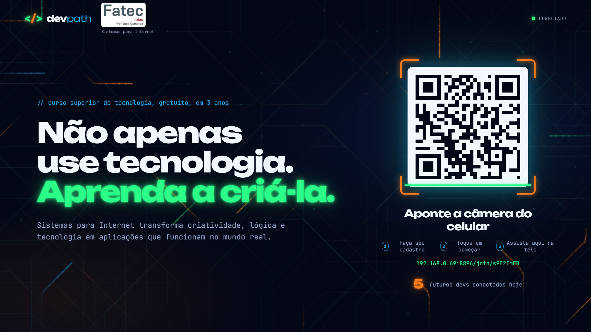

---

## 2. O problema que o projeto resolve

Num estande de feira de profissões, o modelo comum é um banner, folhetos e alguém explicando o curso. Ele tem três falhas de marketing:

| Falha | Consequência |
|---|---|
| O visitante é **passivo**: só ouve ou lê | pouca atenção, pouca lembrança do curso |
| A conversa **não deixa contato** | a Fatec não consegue falar com o interessado depois |
| **Nada é medido** | não dá para saber se a ação funcionou nem o que melhorar |

O DEV PATH ataca as três: o visitante **participa** (usa o celular, escolhe o interesse, reage), **deixa o contato com autorização** e **gera dados** sobre cada etapa.

---

## 3. Público-alvo e objetivo de marketing

- **Público:** estudantes do ensino médio e jovens da região de Jales que estão escolhendo uma faculdade, e também quem quer mudar de área.
- **Objetivo principal:** levar o visitante até a **inscrição no vestibular da Fatec** para Sistemas para Internet.
- **Objetivos de apoio:** captar contatos qualificados (com interesse declarado), fazer o visitante **lembrar e falar do curso** (crachá compartilhável) e **medir** a ação para melhorar as próximas.

---

## 4. A solução: três telas conversando pela internet

| Tela | Quem usa | Para quê |
|---|---|---|
| **TV** (notebook ligado pelo HDMI) | o público do estande | chama a atenção, mostra o código para o celular e a apresentação narrada |
| **Celular** do visitante | o visitante | cadastro, botão "Começar", reações durante a apresentação, crachá e links finais |
| **Painel do operador** (notebook) | a equipe do estande | controla a TV, vê a fila e acompanha as métricas ao vivo |

O celular do visitante usa **a própria internet (4G/5G)** e a TV usa o Wi-Fi da Fatec. Eles não precisam estar na mesma rede: os dois falam com um servidor na nuvem.

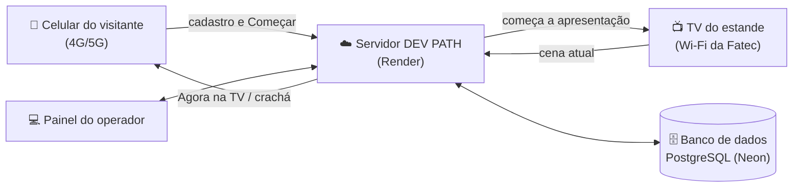

---

## 5. A jornada do visitante, passo a passo

| # | O que acontece | Tela |
|---|---|---|
| 1 | A TV mostra a chamada "Não apenas use tecnologia. Aprenda a criá-la." e o código para o celular. A cada 90 s, um narrador convida quem passa. |  |
| 2 | O visitante aponta a câmera e abre o cadastro: nome, WhatsApp (obrigatório) e e-mail (opcional), o que mais chama a atenção dele e a autorização de contato (LGPD). | 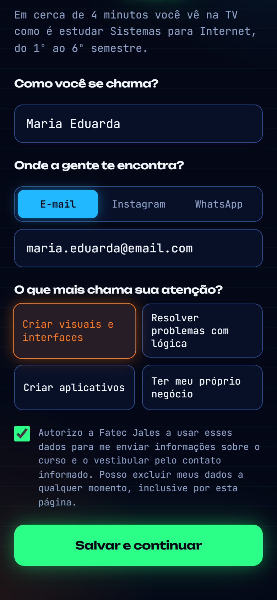 |
| 3 | O celular diz "Tudo certo, Maria. Olhe para a TV e toque no botão." | 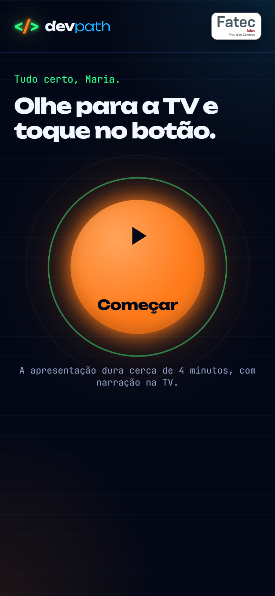 |
| 4 | Ao tocar em **Começar**, a TV chama o visitante pelo nome ("Olá, Maria! Que bom ter você aqui!") e começa a jornada. | 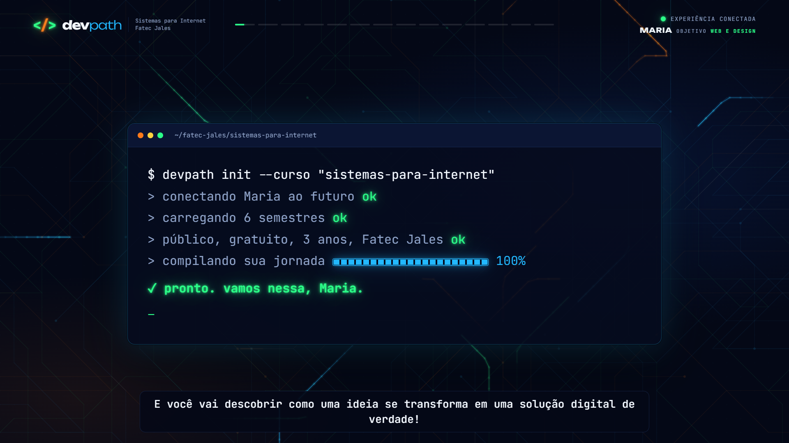 |
| 5 | Durante a apresentação, o celular vira um **controle de reações** (🔥💚🤯🚀) que aparecem na TV. | 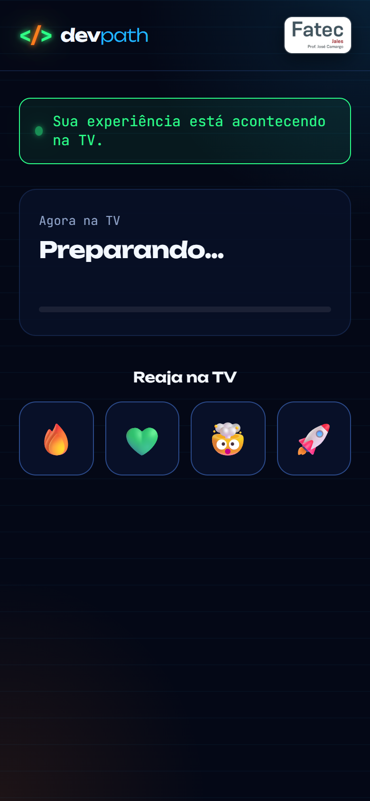 |
| 6 | Cada semestre mostra **todas as disciplinas oficiais**, com uma tradução em linguagem simples. A narração acende cada disciplina no momento em que fala dela, e o semestre termina com "COMPETÊNCIA DESBLOQUEADA ✓". | 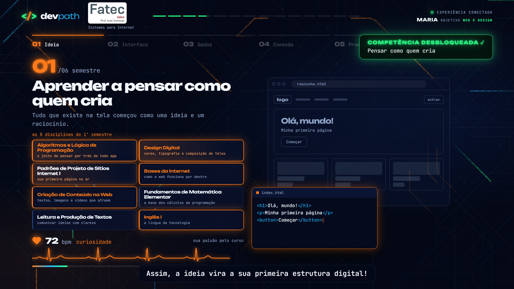 |
| 7 | No final, o crachá aparece na TV com o convite para o vestibular, e a narração avisa que o crachá e os caminhos para conhecer o curso e se inscrever estão no celular. | 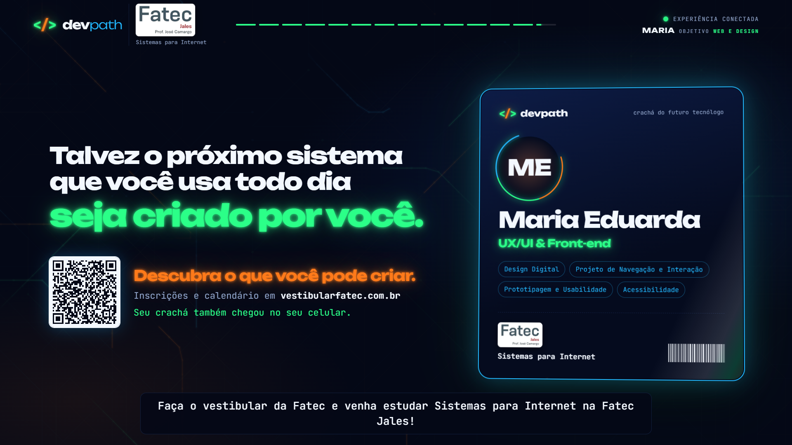 |
| 8 | No celular: o crachá pronto para os stories e os botões "Conhecer o curso" e "Ver processo seletivo". | 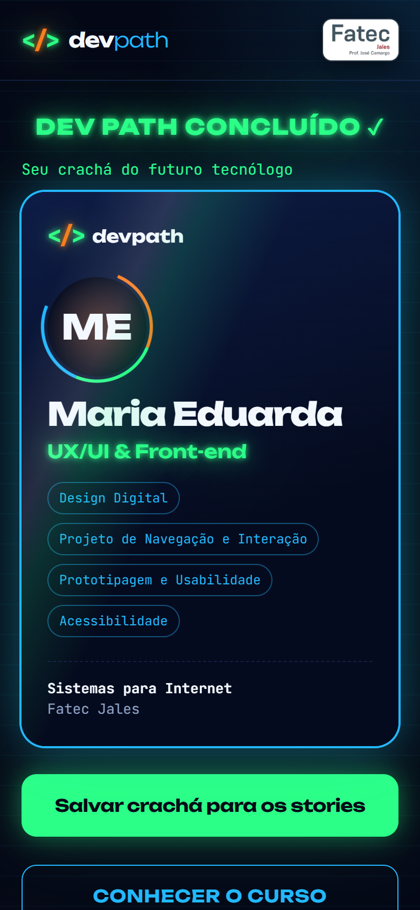 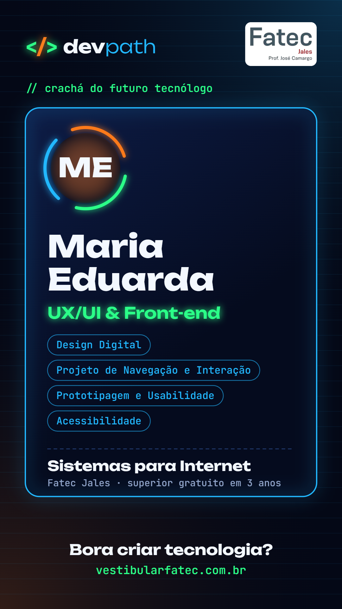 |

A apresentação tem **14 cenas**: boas-vindas, o interesse escolhido, o mapa dos 6 semestres, os 6 semestres, o que dá para criar, as carreiras, a tecnologia em todos os setores, a formação Fatec e o fechamento com o crachá.

---

## 6. Estratégias de marketing aplicadas

### 6.1 O funil AIDA dentro do estande

| Etapa AIDA | Como o DEV PATH faz |
|---|---|
| **Atenção** | TV com animação de circuito, frase forte, narrador chamando quem passa e o contador "futuros devs conectados hoje" |
| **Interesse** | o visitante escolhe o que mais chama a atenção dele (visual, lógica, aplicativos ou negócio), e a apresentação passa a falar disso |
| **Desejo** | narrativa em primeira pessoa com o nome dele, um produto "nascendo" na tela ao longo dos semestres, competências desbloqueadas e carreiras possíveis |
| **Ação** | convite direto para o vestibular, link com rastreamento no celular e código para o vestibular na TV |

### 6.2 Personalização

O nome do visitante é falado em voz alta e aparece na TV e no crachá. O texto do começo e o crachá mudam conforme o interesse escolhido. Personalizar aumenta a atenção e a sensação de que "esse curso é para mim".

### 6.3 Gamificação

"Competência desbloqueada" a cada semestre, um "medidor de paixão" que acelera de 72 para 140 batimentos ao longo da jornada, reações ao vivo pelo celular e o crachá como "recompensa" no fim.

### 6.4 Prova social e marketing boca a boca

- A TV mostra quantas pessoas já participaram no dia ("5 futuros devs conectados hoje").
- O crachá vira uma **imagem 1080×1920 pronta para os stories**: o visitante divulga o curso para os amigos dele, de graça.

### 6.5 Segmentação para o pós-evento

Cada contato guarda o **interesse declarado**. O painel exporta a planilha filtrada por interesse: dá para mandar uma mensagem diferente para quem quer "criar aplicativos" e para quem quer "ter o próprio negócio".

### 6.6 Rastreamento da conversão (UTM)

Os links do vestibular levam `utm_source=devpath`, `utm_medium=celular` ou `tv` e `utm_campaign=<nome do evento>`. Quem administra o site do vestibular consegue ver quantas visitas vieram do estande.

### 6.7 Inteligência artificial

Um curso de tecnologia hoje não pode deixar a IA de fora. A narração mostra a inteligência artificial como **parceira de trabalho**: para programar e analisar dados (3º semestre), para criar produtos mais inteligentes (5º), integrada ao projeto final (6º), entre as coisas que o aluno vai poder criar e entre as carreiras possíveis. Na tela, "Inteligência artificial" aparece em **O que você vai poder criar** e nas **carreiras**, e acende quando é falada. O texto não afirma que existe uma disciplina específica de IA, porque o currículo oficial não tem uma.

### 6.8 O inglês como diferencial

A narração mostra a evolução do inglês **em todos os seis semestres**, do primeiro contato com "a língua da tecnologia" até "o mercado do mundo inteiro", e a disciplina acende na tela. É um argumento forte para o público: o curso prepara para documentação, reuniões e vagas internacionais.

---

## 7. Métricas: o painel do operador

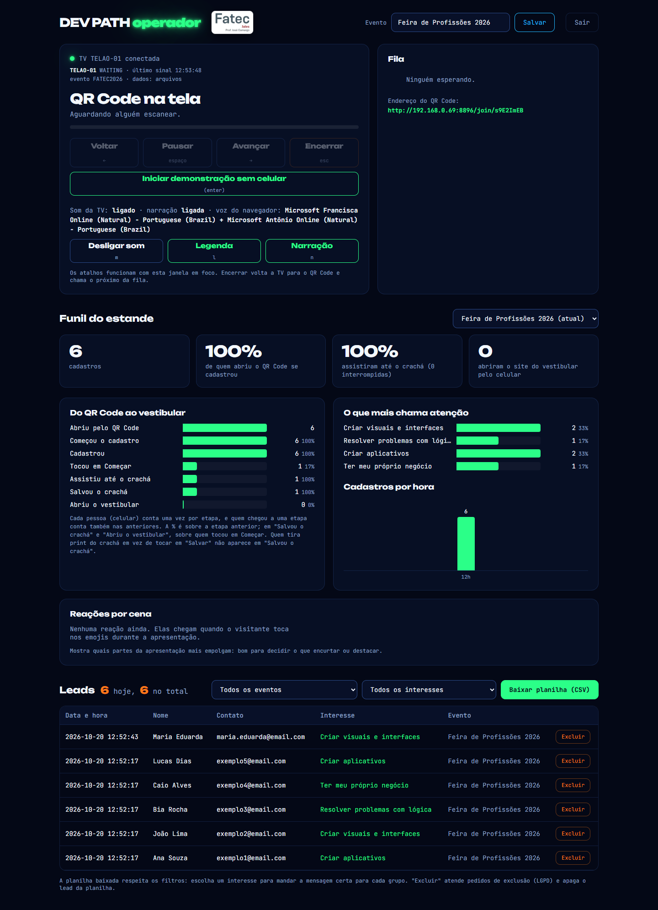

### 7.1 O funil do estande

| Etapa | Como é medida |
|---|---|
| Abriu pelo código | a página de cadastro abriu no celular |
| Começou o cadastro | tocou no formulário |
| Cadastrou | enviou o formulário |
| Tocou em Começar | entrou na fila da TV |
| Assistiu até o crachá | a apresentação chegou ao fim |
| Salvou o crachá | tocou em "Salvar crachá para os stories" |
| Abriu o vestibular | tocou no link do vestibular no celular |

**Regras do cálculo** (revisadas em 20/10/2026 para os números não "passarem de 100%"):

1. **Todas as etapas contam a mesma coisa**: pessoas (um celular conta uma vez), e não cliques.
2. **Quem chegou a uma etapa conta também nas anteriores**: não dá para cadastrar sem abrir a página. Assim cada etapa é sempre menor ou igual à anterior.
3. "Salvou o crachá" e "Abriu o vestibular" são **ramos** da tela final, então a porcentagem deles é calculada sobre quem tocou em Começar.

### 7.2 Indicadores (os quatro números grandes)

| Indicador | O que responde |
|---|---|
| **Cadastros** | quantos contatos a ação gerou (descontando quem pediu exclusão) |
| **% de quem abriu e se cadastrou** | o formulário está fácil? a chamada convence? |
| **% que assistiu até o crachá** | a apresentação prende a atenção até o fim? |
| **Abriram o vestibular** | quantos chegaram à ação final |

Também aparecem: **o que mais chama a atenção** (interesses), **cadastros por hora** (para saber os horários de pico e escalar a equipe) e **reações por cena** (quais partes da apresentação mais empolgam, para decidir o que encurtar ou destacar).

---

## 8. Como funciona por dentro (tecnologia)

| Parte | Tecnologia | Por quê |
|---|---|---|
| Telas (TV, celular, painel) | HTML, CSS e JavaScript puros | rodam em qualquer navegador, sem instalar nada |
| Servidor | Node.js | a mesma linguagem do navegador; leve |
| Tempo real | SSE (*Server-Sent Events*) | o servidor "empurra" avisos para a TV e o celular na hora |
| Banco de dados | PostgreSQL no **Neon** | os dados não se perdem quando o servidor reinicia |
| Hospedagem | **Render** | publica sozinho a cada envio ao GitHub, com HTTPS |
| Narração | vozes neurais do Microsoft Edge (Francisca e Antonio) | voz natural em português do Brasil, de graça |
| Nome falado | o servidor gera o áudio "Olá, {nome}!" na hora | o navegador da TV bloqueia a voz dele quando abre sozinho |
| Música | 9 trilhas originais geradas por código (Python + NumPy) | sem direitos autorais de terceiros |
| Fundo animado | Canvas 2D + CSS | o circuito fica mais transparente a cada cena e some nas últimas telas (de 50% na 1ª tela a 5% no crachá; tabela em `tv.css`) |
| Versões do código | Git e GitHub | histórico de tudo o que mudou |

### 8.1 Áudio da apresentação

- **Duas vozes** se alternam como num diálogo: a narradora (Francisca) e o narrador (Antonio). Todo o texto está **100% em português do Brasil**.
- **Entonação por frase:** exclamações saem mais rápidas, agudas e fortes, e perguntas sobem no fim. Isso deixa a fala dinâmica.
- **Ducking:** a música abaixa sozinha enquanto alguém fala e volta depois.
- **Músicas em sequência**: foram compostas 9 opções (eletrônicas e de rock, três com solo de guitarra e baixo e três com solo de bateria e contrabaixo). A apresentação usa as três com solo de bateria, na ordem 9, 8 e 7. Cada uma toca inteira e emenda na seguinte.
- **Legenda** com o mesmo texto da fala (acessibilidade e ambiente barulhento).

### 8.2 Dois modos de funcionamento

| Modo | Quando usar | Como abrir |
|---|---|---|
| **Nuvem** | celulares em qualquer rede (4G/5G) | `INICIAR-NUVEM.bat` |
| **Notebook** (sem internet) | sem internet no local | `INICIAR.bat` (celulares no mesmo Wi-Fi ou no roteador do notebook) |

---

## 9. LGPD e segurança

- O cadastro **informa a finalidade** e só é enviado com a **autorização marcada**.
- O visitante pode **excluir os próprios dados pelo celular**, e o operador também pode excluir pelo painel.
- As métricas guardam **só códigos aleatórios**, nunca nome ou contato. Por isso continuam válidas mesmo depois de uma exclusão.
- O painel do operador tem **senha**, login por cookie assinado e bloqueio depois de 5 tentativas erradas.
- O código para o celular é **opaco** (não revela nada) e todo o tráfego na nuvem usa **HTTPS**.
- Os dados pessoais **nunca vão para o GitHub**.

---

## 10. Evolução do projeto

| Versão | Principal avanço |
|---|---|
| V3 | código estático, sem cadastro; não controlava a TV |
| V4 (apresentada) | o celular inicia a TV, fila de visitantes, cadastro e crachá |
| **V5** | funil de marketing com métricas, crachá para stories, links com UTM, LGPD completa, **narração com duas vozes**, música, **nuvem** (celular em qualquer rede) e **banco de dados** |

O diário completo, com datas e o que mudou em cada etapa, está em [`PROGRESSO.md`](../PROGRESSO.md).

---

## 11. Testes realizados

| Teste | Resultado |
|---|---|
| Verificações automáticas da API (cadastro, fila, TV, exclusão) | aprovadas |
| Servidor com arquivos e com PostgreSQL | aprovado |
| Apresentação completa no Edge, de ponta a ponta (14 cenas, nome falado, destaques, sem erros) | aprovada |
| Funil com casos difíceis (exclusão, interrupção, cadastros antigos) | números coerentes, nenhum acima de 100% |
| Sequência das músicas | troca no fim de cada música, sem erros |
| Publicação no Render + Neon (`/healthz` → banco PostgreSQL) | no ar |
| **Celular real no 4G/5G com a TV no Wi-Fi da Fatec** | **a fazer no ensaio** |

---

## 12. Custo

**Zero.** Render (plano grátis), Neon (plano grátis), vozes do Edge, músicas próprias e fontes livres. A única limitação do plano grátis é que o servidor "dorme" depois de 15 minutos sem uso: basta abrir a TV uns 5 minutos antes do público.

---

## 13. Limitações e próximos passos

- Testar com o público real e comparar as métricas entre eventos.
- Preencher os links oficiais do curso, do Instagram e do contato da Fatec Jales (hoje o botão leva ao site da Fatec).
- Usar as reações por cena para encurtar as partes menos envolventes.
- Mandar a mensagem pós-evento segmentada por interesse, a partir da planilha.

---

## 14. Onde está cada coisa

| Quero ver… | Arquivo |
|---|---|
| como usar no dia do evento | [16-manual-de-uso.md](16-manual-de-uso.md) |
| o texto falado na TV | [11-roteiro-narracao.md](11-roteiro-narracao.md) |
| como a nuvem funciona | [13-arquitetura-cloud-multirede.md](13-arquitetura-cloud-multirede.md) |
| cada arquivo do código, comando por comando | [README dos docs](README.md) |
