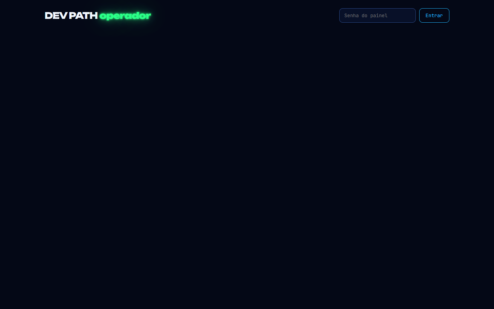
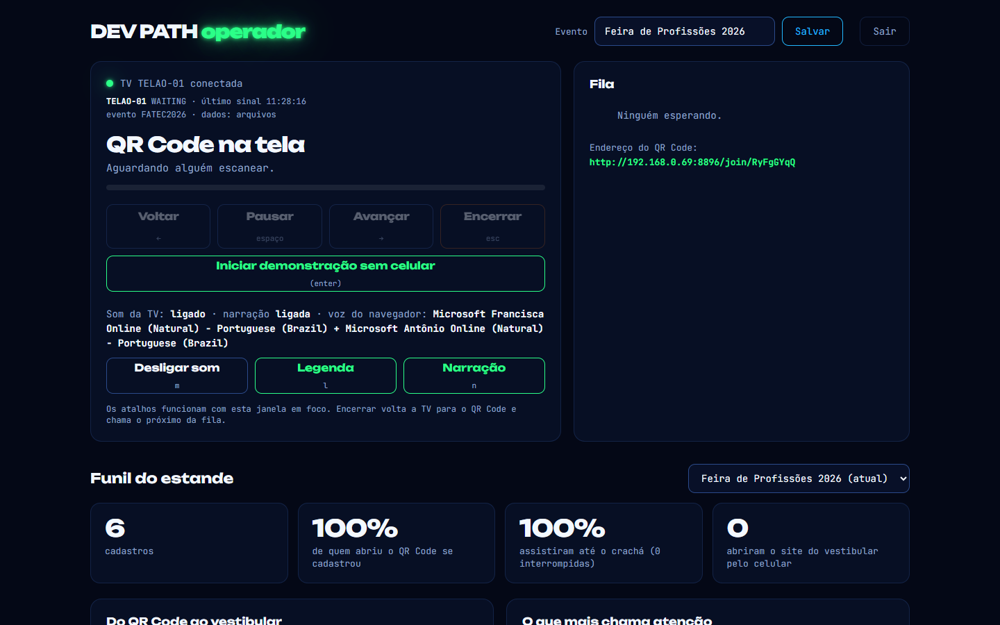
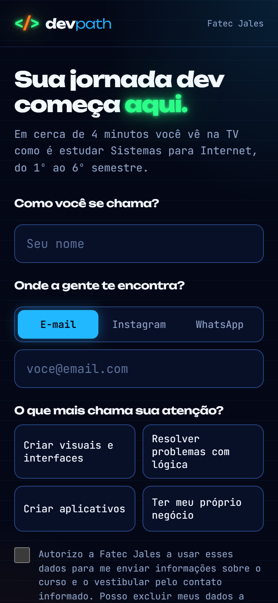

# 16. Manual de uso do DEV PATH — passo a passo

> Para quem vai operar o estande. Não precisa saber programar.
> As imagens são da apresentação de verdade, com dados de exemplo.

**O que você precisa:** um notebook com o Microsoft Edge, uma TV com entrada HDMI e o cabo, internet no notebook (Wi-Fi da Fatec) e este projeto na pasta do notebook.

---

## Parte A — Na véspera do evento

- [ ] Abra https://devpath-uhhd.onrender.com/healthz no navegador. Deve aparecer `"ok":true` e `"banco":"postgres"`. A primeira abertura pode levar até 1 minuto: o servidor grátis "acorda".
- [ ] Confira se você sabe a **senha do painel** (na nuvem, é a `ADMIN_KEY` cadastrada no Render, em *Environment*; no modo notebook, é `fatec`).
- [ ] Faça um **ensaio completo**: TV + um celular no 4G/5G (Wi-Fi do celular desligado) + painel.
- [ ] Deixe o notebook carregado e leve o carregador.

---

## Parte B — Montagem no estande

### Passo 1. Ligue a TV no notebook

1. Ligue o cabo HDMI do notebook na TV.
2. No notebook, aperte **Windows + P** e escolha **Estender**. A TV vira uma segunda tela.

### Passo 2. Abra a apresentação

Dê dois cliques em **`INICIAR-NUVEM.bat`**, na pasta do projeto. Ele abre sozinho:

- **na TV:** a apresentação em tela cheia, já com o som liberado;
- **no notebook:** o painel do operador.

A TV fica assim, esperando o primeiro visitante:


> **Sem internet no local?** Use o **`INICIAR.bat`** (modo notebook). Os dados ficam no próprio notebook e os celulares precisam estar no **mesmo Wi-Fi** do notebook (ou no roteador do notebook: *Configurações → Rede → Hotspot móvel*). A senha do painel nesse modo é `fatec`.

### Passo 3. Abra uns 5 minutos antes do público

O servidor grátis "dorme" depois de 15 minutos sem uso. Com a TV aberta, ele fica acordado sozinho.

---

## Parte C — O painel do operador

### Passo 4. Entre no painel

No notebook, digite a senha e clique em **Entrar**.



### Passo 5. Dê um nome ao evento

No topo, em **Evento**, escreva o nome da ação (por exemplo, "Feira de Profissões 2026") e clique em **Salvar**. Todos os cadastros e métricas ficam marcados com esse nome, e depois dá para comparar eventos.

### Passo 6. Conheça os controles



| Botão | Faz | Atalho (com o painel em foco) |
|---|---|---|
| **Voltar / Avançar** | volta ou pula uma cena | ← / → |
| **Pausar** | pausa e continua | espaço |
| **Encerrar** | para a apresentação, volta a TV para o código e chama o próximo da fila | Esc |
| **Iniciar demonstração sem celular** | roda a apresentação sem cadastro (para chamar a atenção ou ensaiar) | Enter |
| **Desligar som** | deixa a TV muda | M |
| **Legenda** | liga ou desliga a legenda | L |
| **Narração** | liga ou desliga a voz | N |

À direita fica a **Fila**: quem já tocou em Começar e está esperando a TV.

---

## Parte D — O que o visitante faz (e o que você fala)

**Para convidar:** "Quer ver como seria a sua faculdade de tecnologia? Aponta a câmera do celular para a TV!"

### Passo 7. O visitante aponta a câmera para o código

Abre a página de cadastro no celular dele.



### Passo 8. Preenche o cadastro

Nome, onde quer ser encontrado (**e-mail, Instagram ou WhatsApp**), o que mais chama a atenção e a **autorização** de contato. Depois toca em **Salvar e continuar**.


### Passo 9. Toca em Começar


Se a TV estiver ocupada, o celular mostra a posição na fila ("Você é o próximo"). Quando a TV fica livre, a vez dele começa sozinha.

### Passo 10. A TV chama o visitante pelo nome

A narradora diz "Olá, Maria! Que bom ter você aqui!" e a jornada começa.


### Passo 11. Assiste e reage

Durante os cerca de 4 minutos, o celular mostra a cena atual e os botões de reação. Cada toque aparece na TV.


Na TV, cada semestre mostra as disciplinas. Elas acendem quando a narração fala delas, inclusive o **inglês**, que aparece em todos os semestres.


### Passo 12. Recebe o crachá

No final, a TV mostra o crachá e o convite para o vestibular:


E o celular mostra o crachá com os botões **Salvar crachá para os stories**, **Conhecer o curso** e **Ver processo seletivo**:


**Diga:** "Salva o crachá e posta! E aí no celular já tem o link para se inscrever no vestibular."

Depois disso, a TV volta sozinha para o código e chama o próximo da fila.

---

## Parte E — Durante o evento

- **Acompanhe o funil** no painel: ele atualiza ao vivo a cada cadastro.
- **Alguém desistiu no meio?** Clique em **Encerrar**: a TV volta para o código e chama o próximo.
- **Ninguém no estande?** Clique em **Iniciar demonstração sem celular** para a TV chamar a atenção.
- **Ambiente muito barulhento?** Mantenha a **legenda** ligada.

---

## Parte F — Depois do evento

### Passo 13. Baixe a planilha de contatos

Role o painel até **Leads**. Escolha o evento e, se quiser, um interesse, e clique em **Baixar planilha (CSV)**. Ela abre direto no Excel.


> **Dica de marketing:** baixe uma planilha por interesse e mande uma mensagem diferente para cada grupo. Exemplo: para quem escolheu "Criar aplicativos", fale do 5º semestre (aplicativos para celular).

### Passo 14. Pedidos de exclusão (LGPD)

Se alguém pedir para apagar os dados, clique em **Excluir** na linha da pessoa. O próprio visitante também pode excluir pelo celular, no botão "Excluir meus dados".

### Passo 15. Usou o modo notebook (sem internet)?

Para juntar esses cadastros aos da nuvem, abra o terminal na pasta do projeto e rode:

```
npm run importar
```

Pode repetir sem medo: ele não duplica cadastros.

---

## Parte G — Problemas e soluções

| Problema | Solução |
|---|---|
| A TV abriu no notebook, não na TV | aperte Windows + P → Estender; arraste a janela para a TV e aperte **F** |
| A TV mostra "Ativar áudio e iniciar evento" | clique uma vez na TV (o navegador exige um clique para liberar o som) |
| A TV demora para abrir | o servidor grátis estava dormindo: espere até 1 minuto |
| O celular não abre a página | confira a internet do celular; no modo notebook, o celular precisa estar no mesmo Wi-Fi |
| O painel pede a senha de novo | o login vale 12 horas ou o servidor reiniciou: entre de novo (a fila e os números continuam) |
| Sem som | verifique o volume da TV, o botão "Desligar som" no painel e o cabo HDMI |
| A TV ficou "presa" numa apresentação | clique em **Encerrar** no painel |
| Uma apresentação antiga voltou ao abrir a TV | se a TV ficou fechada mais de 10 minutos, ela é encerrada sozinha; se não, clique em **Encerrar** |

---

## Parte H — Atalhos direto na janela da TV

| Tecla | Faz |
|---|---|
| Enter | demonstração sem celular |
| → / ← | avança / volta cena |
| Espaço | pausa / continua |
| Esc | encerra e volta ao código |
| M / L / N | som / legenda / narração |
| F | tela cheia |
| H | ajuda |
| Alt + F4 | fecha a apresentação |

---

Documentação completa do projeto (para a banca): [15-documentacao-para-professores.md](15-documentacao-para-professores.md).
